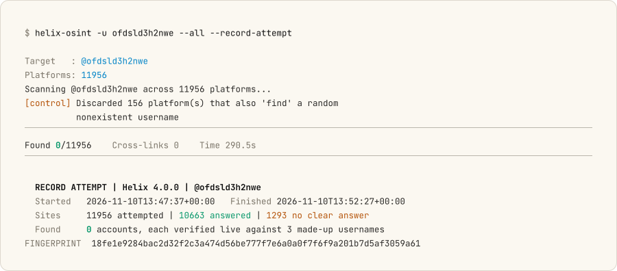
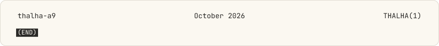

<picture>
  <source media="(max-width: 600px) and (prefers-color-scheme: dark)" srcset="assets/man-narrow-dark.svg">
  <source media="(max-width: 600px)" srcset="assets/man-narrow-light.svg">
  <source media="(prefers-color-scheme: dark)" srcset="assets/man-dark.svg">
  <source media="(prefers-color-scheme: light)" srcset="assets/man-light.svg">
  
</picture>

<p><b>PROJECTS</b></p>
<dl><dd>

**[helix](https://github.com/thalha-a9/helix)**(1)<br>
Username OSINT. Give it a name and it asks 11,988 sites whether that account exists: the Sherlock, WhatsMyName and Maigret lists, plus 3,683 Mastodon, Misskey, Lemmy and PeerTube servers. Every account it finds gets checked again on the same site with two usernames that can't exist. If the site says yes to those as well, the hit is thrown away. Whatever survives is graded HIGH, MEDIUM or LOW for how likely it is to be the same person.

```
pipx install helix-osint
helix-osint -u someone --all
```

On [PyPI](https://pypi.org/project/helix-osint/), and in review for BlackArch.

**[git-mistake](https://github.com/thalha-a9/git-mistake)**(1)<br>
For the bad day in git: a detached HEAD, a reset you regret, commits that look gone. You say what went wrong, it finds the way back through the reflog, tells you what it's about to run, and keeps away from anything that would make it worse.

</dd></dl>

<p><b>EXAMPLES</b></p>
<dl><dd>

Helix on a username nobody has ever used, so any account it reports would be a false positive. This is the real run from 30 October 2026 with Helix 3.6.0.

<picture>
  <source media="(max-width: 600px) and (prefers-color-scheme: dark)" srcset="assets/run-narrow-dark.svg">
  <source media="(max-width: 600px)" srcset="assets/run-narrow-light.svg">
  <source media="(prefers-color-scheme: dark)" srcset="assets/run-dark.svg">
  <source media="(prefers-color-scheme: light)" srcset="assets/run-light.svg">
  
</picture>

The fingerprint seals the evidence file, so anyone can check later that the result wasn't edited: `helix-osint --verify-evidence`.

</dd></dl>

<p><b>EXIT STATUS</b></p>
<dl><dd>

**0** accounts found for the made-up name, across all 11,988 sites.<br>
**111** sites said yes to every name and were dropped before they could count.

</dd></dl>

<p><b>OPTIONS</b></p>
<dl><dd>

**--osint**<br>
Finding people and accounts from public sources, and proving each finding holds up.

**--network**<br>
Traffic and protocol analysis, what a host exposes to the world, hardening reviews.

**--pentest**<br>
Recon, enumeration, exploitation, privilege escalation. Only with written permission and an agreed scope, and everything found goes back to whoever owns the system.

**--automate**<br>
Jobs that run on a schedule or on an event, are safe to retry, and stay quiet unless something breaks.

</dd></dl>

<p><b>NOTES</b></p>
<dl><dd>

My tools run on your own machine. No account to make, no telemetry, and no one else's server seeing who you look up.

If a result can't be verified, it doesn't get printed.

If I do something twice, it becomes a script. If I do it every week, it becomes a tool.

</dd></dl>

<p><b>BUGS</b></p>
<dl><dd>

If Helix shows you an account that isn't real, that's a bug and I want to see it: [report a false positive](https://github.com/thalha-a9/helix/issues/new?template=false_positive.yml).

</dd></dl>

<p><b>SEE ALSO</b></p>
<dl><dd>

[helix](https://github.com/thalha-a9/helix)(1), [git-mistake](https://github.com/thalha-a9/git-mistake)(1), [Helix OSINT Labs](https://helix-osint.hashnode.dev) for the write-ups behind the tools.

</dd></dl>

<p><b>AUTHOR</b></p>
<dl><dd>

Thalha Ahmed. Happy to talk about OSINT tooling, security work, or either project; reach me here on GitHub or through the blog.

</dd></dl>

<picture>
  <source media="(max-width: 600px) and (prefers-color-scheme: dark)" srcset="assets/end-narrow-dark.svg">
  <source media="(max-width: 600px)" srcset="assets/end-narrow-light.svg">
  <source media="(prefers-color-scheme: dark)" srcset="assets/end-dark.svg">
  <source media="(prefers-color-scheme: light)" srcset="assets/end-light.svg">
  
</picture>
